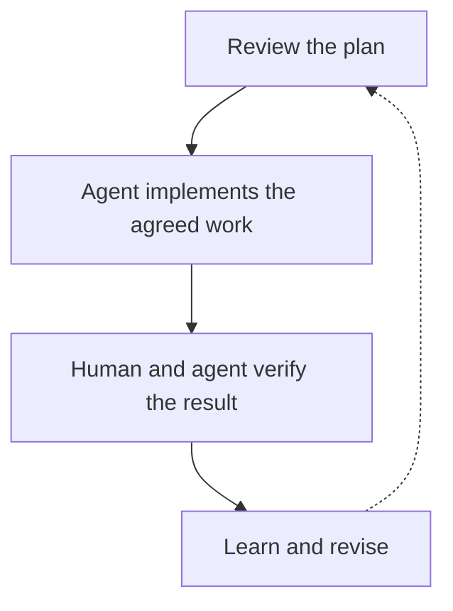

I’ve done 100 times more software engineering in the last two years with AI than I did in my first six.

The change is in what fills my day. I review plans. I make architecture decisions. I learn new architectures, concepts, and tools while building things with them. Agents take on a lot of the tedious, time-consuming implementation that used to sit between a decision and a working result.

I still work hard. I just get to spend much more of that effort on the parts of engineering that interest me.

> The biggest change in my day is how much time I can spend making engineering decisions—and learning enough to make better ones.

## 1. The implementation used to take most of the room

### 1.1. Familiar work still consumes attention

You can know what needs to happen and still spend a substantial part of your day making it happen.

Center the element. Wire the form. Move data between two slightly different shapes. Implement another familiar pattern. Interpret a designer’s “make this look good” comment, change the spacing, and repeat the conversation.

Those tasks can require care. Some contain genuinely difficult problems. But after enough years, much of the work is familiar execution. You are spending attention on something you already understand, often because there is no practical way to skip doing it by hand.

That was a large part of my experience. A decision could be relatively quick; implementing all its consequences took the afternoon.

With a capable coding agent, I can hand over much more of that execution. I can describe the result, inspect a proposal, correct a misunderstanding, and let the agent carry the mechanical work through.

The interesting question becomes what I do with the attention that frees up.

### 1.2. Where that attention goes now

Here is the division of work I am aiming for. The boundaries move with the task, but the distinction is useful:

| Work                | What I can delegate                                           | Where I want to spend my attention                         |
| ------------------- | ------------------------------------------------------------- | ---------------------------------------------------------- |
| A form or interface | Repetitive markup, styling, and wiring                        | Behavior, accessibility, and whether it solves the problem |
| An API integration  | Mapping payloads, adding handlers, connecting existing pieces | Contracts, failure behavior, and data ownership            |
| A new feature       | Implementing an agreed plan and exploring alternatives        | Scope, architecture, and unnecessary complexity            |
| An unfamiliar tool  | Setting up a bounded experiment                               | Understanding its assumptions and deciding whether it fits |
| Verification        | Running checks and collecting evidence                        | Whether the checks establish the behavior we actually need |

## 2. Plan review is engineering work

### 2.1. The notification feature that could become five projects

Imagine adding notifications to an application. This is a hypothetical example, but it captures the shift well.

An agent proposes a background worker, a queue, retry logic, a preferences table, and several abstractions for future notification channels. It can produce a lot of the implementation quickly.

Before it starts, there are decisions worth making:

- **Scope:** does this application need a separate worker yet, or would a simpler design meet the requirement?
- **Duplicate delivery:** what happens if delivery succeeds but the acknowledgement is lost?
- **Durability:** which notifications must survive a restart?
- **Failure boundaries:** should a delivery failure affect the action that triggered it?
- **Complexity:** are we building for a real requirement or a future we have merely imagined?

I want to spend my effort reviewing that plan. I want to understand its failure modes and decide which complexity the application has earned.

Once the direction is sound, writing another handler or adapting a payload is a reasonable thing to delegate. An agent doing that work gives me more opportunities to exercise judgment across the system.

Sometimes the most useful decision will be to reject half the proposed architecture. Other times it will be to insist on a constraint the agent overlooked. Both are engineering, even when the resulting diff is mostly generated.



_An illustrative working loop: implementation is delegated, while decisions and learning stay connected to the result._

### 2.2. A prompt that makes the review concrete

For that hypothetical feature, a useful request could look like this:

```text
Before implementing notifications,
propose the smallest design that
meets the current requirements.

Explain:
- Where the work runs, and why.
- Failure, retry, duplicate handling.
- Changes to data and interfaces.
- Checks for user-visible behavior.

List assumptions and open decisions.
Add no future channels or services
without a current requirement.
Wait for plan review before coding.
```

This gives me something specific to inspect before there is a large diff. I can challenge the assumptions, choose a simpler boundary, or ask for evidence about a failure case.

## 3. Building has become part of how I learn

This is the part I find most exciting: I learn as I go.

### 3.1. Get a working experiment in front of me

A new architecture or unfamiliar tool used to come with a substantial implementation cost before I could meaningfully explore it. There was setup to understand, syntax to learn, integrations to connect, and enough code to write before the tradeoffs became tangible.

AI makes it easier to get a working version in front of me. I can ask for a plan, examine why a component exists, try a simpler alternative, and explore what happens when an assumption changes.

Consider another hypothetical example: a small service needs asynchronous work. Instead of spending all my available time assembling a queue integration, I can use an agent to build a bounded experiment. Then I can concentrate on delivery semantics, idempotency, retry behavior, and what the system does when the worker disappears halfway through a job.

The implementation gives the concepts something concrete to attach to. I can change a condition and inspect the consequence. I can compare two designs while the problem is still fresh in my head.

For the background-job example, the experiment could be deliberately small:

1. **Implement one job.** Keep the surrounding feature out of the experiment.
2. **Interrupt it halfway through.** Observe what the system actually retains.
3. **Run it again.** Check whether duplicate execution creates a second side effect.
4. **Inspect the explanation and the code.** Identify which mechanism produced the observed behavior.

### 3.2. An explanation is something to check

Of course, a plausible explanation from an agent is not enough to establish that I understand the system. I still need to inspect the implementation, consult the relevant documentation, and check behavior. An agent can confidently make the same wrong assumption in both its code and its explanation.

But I get to reach those questions sooner. More of my learning happens around a system I can examine and change, instead of waiting until I have finished all the supporting code.

## 4. The new bottleneck is often my judgment

### 4.1. Spend review effort on consequential constraints

In this way of working, implementation can move ahead faster than I can make good decisions about it.

That makes plan review more consequential. A weak assumption can spread through several generated changes before I have properly challenged it. A technically correct implementation can still solve the wrong problem. A neat abstraction can leave the next change harder than it needed to be.

I have to decide what matters before I spend my attention correcting everything equally.

Is this a public contract we need to preserve? Is it a security boundary? Will the choice make failures harder to diagnose? Or am I about to spend twenty minutes making an agent arrange constants according to my preferred handwriting?

I care much more about the first set of questions. Cosmetic consistency can often be handled by tooling. The decisions that change behavior, risk, and the cost of future work deserve my attention.

### 4.2. More decisions still take energy

That does not make the work effortless. Reviewing plans, weighing alternatives, and learning an unfamiliar system all require concentration. Removing slow implementation does not remove the thinking that surrounds it. Sometimes it gives me more thinking to do in the same day.

## 5. I still own the result

Delegating implementation does not give me someone else to blame for it.

If I accept an architecture, merge a change, or release a feature, I am responsible for the decisions I made and the evidence I accepted. “Claude wrote it” or “Codex did that part” describes how the code was produced. It does not explain why it was safe to ship.

I do not need to personally type every line to contribute engineering judgment. I do need a way to establish that the important requirements hold. Depending on the change, that can involve reviewing the design, examining consequential code paths, running tests, exercising the actual product, or asking a fresh reviewer to challenge the result.

The useful shift is having more room for that work because I am doing less repetitive implementation myself.

## 6. What I want to get better at now

I want to become better at reviewing a plan before it turns into a large diff. Better at recognizing when a familiar architecture is unnecessary. Better at understanding an unfamiliar tool well enough to evaluate the agent’s use of it. Better at stating the constraints that actually protect the system.

### 6.1. Try it on one bounded feature

For someone trying this way of working, I would start with one bounded feature:

1. Ask for a plan before the implementation. Review its assumptions, boundaries, and failure behavior.
2. Delegate a complete piece of execution, with a clear outcome and a way to check it.
3. Use the saved implementation effort to investigate one important design choice or unfamiliar concept.
4. Check the result against the original requirement, including the real behavior the user reaches.
5. Notice where your attention went. More generated code is less interesting than a better decision you now had time to make.

### 6.2. Keep the experience; change how you use it

I spent my first six years building useful things and learning the craft. Those years are part of why I can evaluate plans and make architecture decisions now.

What AI changed is how much of my working day I get to spend doing that. I can explore more ideas, work with concepts I am still learning, and leave much more of the repetitive execution to agents.

That is what I mean by 100 times more engineering.
