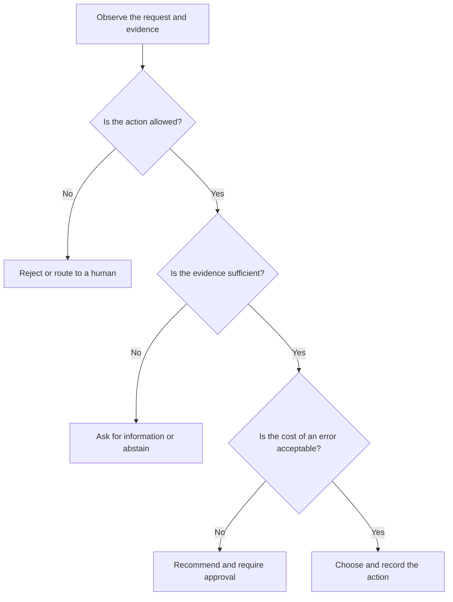

A support system does not always need another paragraph. Sometimes it needs to decide whether a ticket should be routed to billing, security, or a human queue. A deployment assistant may need to choose between continuing, rolling back, or asking for approval.

Those are decision tasks. The output is not mainly prose; it is a choice made from observations, constraints, and incomplete evidence.

I use **decision model** here as a practical label for a system that selects or ranks actions. It is not a settled universal category, and it is not a claim that every vendor uses the term in the same way. The label is useful when it makes us ask what the system is allowed to choose, what evidence it must show, and when it should stop.

## 1. Text generation, reasoning, and decisions are different jobs

A generative model produces a continuation: an explanation, draft, summary, or code sample. A reasoning model spends more effort working through a difficult problem before producing an answer. A decision model focuses the interface on selecting, ranking, or declining actions under explicit conditions.

These jobs can be combined in one workflow, but they should not be confused.

| Job | Main output | Useful question |
| --- | --- | --- |
| Generate | Text, code, or another artifact | “What could we say or make?” |
| Reason | An answer supported by intermediate analysis | “What follows from these facts and constraints?” |
| Decide | An action, ranking, or abstention | “Which allowed option should happen next?” |
| Apply rules | A deterministic result | “Does this condition match?” |

A language model can produce a recommendation without being a reliable decision system. A rules engine can make a consistent decision without understanding an unstructured request. The design should make clear which part is doing which job.

## 2. Give a decision model a real choice

A decision model needs more than a request to “choose the best option.” It needs a choice set and a reason for comparing the options.

Consider a hypothetical support queue. Each incoming ticket has a message, a customer plan, recent account events, and a set of allowed routes. The model can recommend **billing**, **technical support**, **security**, or **human review**.

A useful decision record might contain:

```json
{
  "action": "human_review",
  "alternatives_considered": ["billing", "technical_support", "security"],
  "evidence": ["message mentions an unfamiliar invoice", "account event is incomplete"],
  "constraints": ["do not change account state", "security cases require manual review"],
  "confidence": 0.61,
  "abstain_reason": "The available evidence does not distinguish billing from account compromise"
}
```

The exact number is not the important part. The useful properties are that the allowed actions are visible, the evidence can be checked, and uncertainty has somewhere to go.

## 3. Decide whether the model should act at all

A decision workflow should not begin with autonomy. It should begin with the cost of being wrong.



A model can still be useful when it is not allowed to execute the final action. It can rank options, explain the deciding evidence, and prepare a request for approval. The boundary between recommendation and execution should be explicit.

## 4. Compare alternatives instead of inventing a score

A decision model can hide a weak comparison behind a precise-looking number. “Option B scores 8.4” is not useful unless the reader knows what the score means, how the weights were chosen, and which requirements could disqualify an option altogether.

A stronger comparison separates:

- **hard constraints** that eliminate an option;
- **objectives** that make one remaining option preferable;
- **uncertainty** in the facts or predicted outcome;
- **reversibility** of the action;
- **approval requirements** for the side effect.

For example, a deployment assistant might eliminate a release that has no rollback path before comparing latency and cost among the remaining candidates. It should not trade away a safety constraint because a weighted average made the total score look attractive.

This is the model-level companion to [my article about getting an agent to compare its options](/blog/a-decision-is-more-than-another-menu). The agent can perform the comparison, but the decision model still needs a well-defined choice set and a reviewable contract.

## 5. Evaluate the decision, not just the prose

A decision system needs tests that reflect the consequences of its choices.

Useful measures include:

- **Decision accuracy:** Did it choose the intended option on cases with a known answer?
- **Constraint violations:** Did it select an action that was forbidden even when the recommendation sounded plausible?
- **Abstention quality:** Did it hand off the cases where evidence was insufficient?
- **Calibration:** Do confidence levels correspond to how often choices are correct?
- **Consistency:** Does the same evidence produce materially different choices without a changed requirement?
- **Cost and latency:** Is the extra reasoning worth the operational expense?
- **Human override patterns:** Are reviewers correcting a specific class of recurring mistakes?

A generated explanation can be persuasive while the action is wrong. Score the action and its evidence separately. Keep representative difficult cases in a regression set so a prompt, model, or data change cannot silently remove a useful refusal.

## 6. Where decision models fit

The workshop curriculum points to several current examples, including the [OpenAI Decisions API](https://developers.openai.com/api/docs/guides/decisions), [Microsoft Decision-1](https://commandline.microsoft.com/microsoft-decision-1-model-foundry/), and [TypeSafe AI's Jev](https://typesafe.ai/). These are useful references for seeing how decision-focused systems are being described, but the implementation details and availability can change.

The general architecture remains understandable without choosing a vendor:

1. Collect the facts the decision is allowed to use.
2. Define the actions and hard constraints.
3. Compare or rank the valid alternatives.
4. Return evidence, uncertainty, and an abstention path.
5. Require approval before consequential side effects.
6. Record the result for evaluation and later review.

That structure can use rules, a classifier, a language model, a reasoning model, or a combination. The name of the model does not remove the need to define the decision contract.

## 7. A decision model is a boundary, not a replacement for judgment

A good decision model makes judgment easier to inspect. It shows what the system saw, what it could choose, which constraint mattered, and why it stopped or acted.

That visibility matters more as the action becomes harder to reverse. A recommendation about a draft title can be low risk. Changing an account, approving a payment, or deploying software needs narrower permissions and stronger evidence.

The right question is not “Can the model decide?” It is “Which decision can this system make safely, from which evidence, with which approval boundary, and how will we know when it is wrong?”
