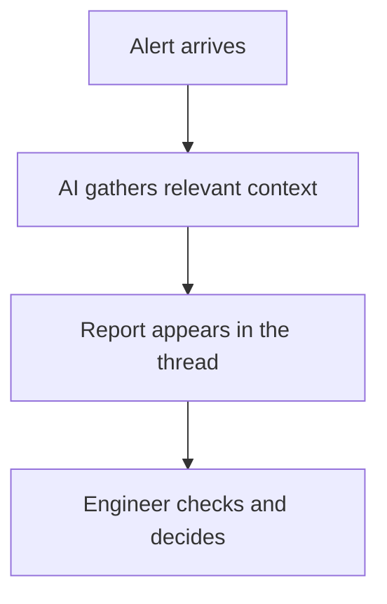

An alert says a service is down. Before anyone can decide what to do, they need to find out whether it's still down, what happened around the same time, and where to look next.

That first round of investigation is the idea behind **Heimdall**, my AI incident-context reporter. It reads alerts, gathers relevant evidence, and puts a report in the alert thread for the person handling the incident.

Think of it as starting the investigation somewhere around **5/10 instead of 0/10**. There is already a timeline, some checked observations, and a possible direction to explore. The engineer can spend their attention testing that explanation and deciding what to do.

## 1. Turn a notification into a useful starting point

An alert names a symptom. A useful investigation connects it to the surrounding situation:

- Is the problem still happening, or has the service recovered?
- Do several alerts describe different symptoms of the same incident?
- What do the relevant metrics, logs and recent changes show?
- Has something similar happened before, and what is different this time?

Heimdall gathers that context before writing its report. If a service has already recovered, the report can lead with that fact. If the problem remains active, it can point to observations that deserve attention rather than repeat the alert in more words.

## 2. An example from an alert thread

The original alert below reports that a deployment has no available replicas. Heimdall's reply starts with a different piece of information: the incident has resolved. It gives the period of unavailability and the alert window, then organizes findings, related evidence and a recommended action.

<figure>
  
  <figcaption>
    A redacted example: the alert above, Heimdall's report below. Open the image to view it at full size.
  </figcaption>
</figure>

The detailed findings are redacted, but the change in starting point is visible. The person opening this thread already has a status update and a timeline, with links to replica availability and queue depth. They can follow those leads instead of beginning by searching for every piece themselves.

## 3. Useful context doesn't have to be the final answer

An incident report can be valuable before the root cause is settled. Knowing that availability recovered, that a queue is still growing, or that a similar event happened yesterday helps narrow the next question.

Earlier reports can supply leads too, provided their explanations remain hypotheses. A recurring symptom doesn't prove a recurring cause. The engineer still needs to inspect the evidence, question missing information, and decide whether a proposed response makes sense.

Heimdall's job is to prepare that starting point. It isn't an automatic service-repair system, and its report can be incomplete or wrong. The value is putting relevant information in front of the operator early enough to make the next step more informed.
