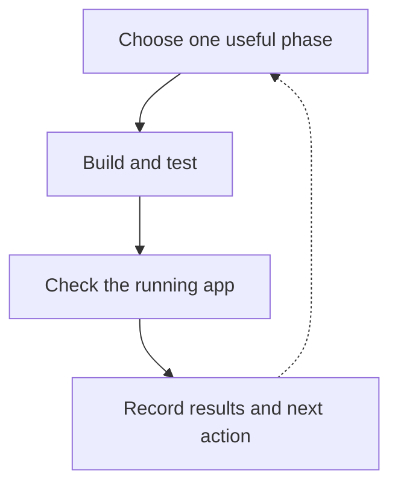

The request form is on the screen. The save endpoint passes its checks. Then someone tries to use the form and discovers the fields won't accept input.

Calling it done makes the user responsible for finding the gap.

My **insured-vibe-coding** skill connects the work around implementation: keep the current task visible, build in useful phases, test meaningful scenarios, check the running application, and retain evidence before moving on. The name describes the protection the process aims to provide, not a guarantee against defects.

The [complete skill and setup instructions](/prompts/insured-vibe-coding) are in the Prompt Library. A hypothetical equipment-request app shows how the workflow fits together.

## 1. Keep one current view of the work

The app's agreed specification says employees can request equipment, see their own pending requests, and return later to find them saved. Managers will review requests in a later phase. Email delivery and deployment are outside the assignment.

“Build the equipment app” is too large to verify as one undifferentiated task. “Create the form component” is too small to establish a useful result. A better first phase is **submit a request and find it in your own list**. It crosses the screen, service and persistence boundaries while giving the next phase something real to build on.

The skill keeps a compact kanban in the project's documentation, usually `docs/insured-vibe-coding/kanban.md`. It records Doing, Todo and Done, with an exact next action. The agent updates it when starting and completing a phase.

During this phase, the board might say: service checks complete; browser flow untested; next, sign in and submit through the form. Manager review stays in Todo. It records current work, not a diary of edits.

For this UI phase, the loop is simple:



A new session can see what remains without confusing “the form exists” with “request submission works.”

## 2. Build and test the whole phase

The process starts from an existing specification and calls on separate planning and design guidance before implementation.

Before writing assertions, the agent enumerates the meaningful scenarios for the phase. For equipment requests, those include a valid submission, a missing reason, a failed save, repeated submission, and a caller trying to reach another employee's requests. The actual specification decides the expected behavior.

Each test must detect the relevant mistake. Check the saved values and owner, and establish that a rejected operation created no record. A failure deserves investigation; changing the expectation merely to get green defeats the purpose.

The skill calls for test-driven development during the build, not just testing after all the code is written. Once the tests contain the scenarios, their disposable enumeration list can go away. The [testing-philosophy article](/blog/ai-can-write-your-tests-what-makes-them-worth-trusting) explains the reasoning behind those checks.

## 3. Write the real-app checks before driving the app

Tests at the service boundary don't establish that a person can type into the rendered form, submit it, or understand what happened. This phase needs a planned check in the running application.

The agent writes that plan before execution, building it from the user's actions and promised results. A few proposed rows for our example are:

| User action                  | What should happen                                              | Evidence to inspect                           |
| ---------------------------- | --------------------------------------------------------------- | --------------------------------------------- |
| Sign in and open requests    | The actual fields accept input and navigation reaches the form  | Rendered interaction and resulting page       |
| Submit a valid request       | One pending request appears for that employee                   | Visible result and persisted record           |
| Reload the list              | The saved request remains                                       | Reloaded page and the same record             |
| Submit with a missing reason | A useful error appears; no request is created                   | Validation, request activity and stored state |
| Encounter a save failure     | The interface shows failure and supports the specified recovery | Actual error path and resulting state         |

These are planned checks, not results. They include prerequisites: if employees reach the form by signing in, login needs checking too. A pre-authenticated fixture can leave that part of the journey unexamined.

Review the plan for missing scenarios before executing it. For larger work, the skill calls for a fresh reviewer and prefers a dedicated QA agent. The executor must use the rendered controls. An endpoint call doesn't prove the form works, and a successful-looking screenshot doesn't prove persistence.

## 4. Close the phase with evidence

Suppose the browser pass exposes the frozen field from the opening example. The phase stays in Doing. The agent records the reproduction, finds the cause, repairs it, and reruns the affected checks.

The same applies to a check that cannot run. Missing test credentials or an unavailable dependency leave an open obligation. “Blocked” is useful information; silently treating it as a pass changes the meaning of Done.

A phase closes when its automated checks pass and every required real-app row has either an observed passing result or a genuine reason it doesn't apply. For a purely internal logic phase with no UI or user-facing flow, the skill records that no UI pass is needed; it doesn't invent a screen to test.

The kanban then points to the evidence and names the next action, such as manager review. Detailed observations stay in the QA plan, keeping the board short enough to resume from. Release remains separate when it wasn't authorized.

## 5. Adopt the process deliberately

Insured Vibe Coding is explicitly enabled by name or by a project instruction. On first adoption, it adds a reference to the relevant `AGENTS.md` or `CLAUDE.md` so later sessions know the workflow applies.

With the [skill and its dependencies](/prompts/insured-vibe-coding) available, the task request can stay short:

```text
Use insured-vibe-coding for the agreed equipment-request app spec.
Start with employees submitting a request and seeing it in their own list.
Manager review comes next. Keep email and deployment outside the task.
```

The request supplies the task; the skill supplies the workflow. Its supporting skills and the application's test environment still need to be available. The process depends on well-chosen phases, meaningful assertions and a complete QA plan. Keeping their evidence connected makes unfinished work visible to the next session.
