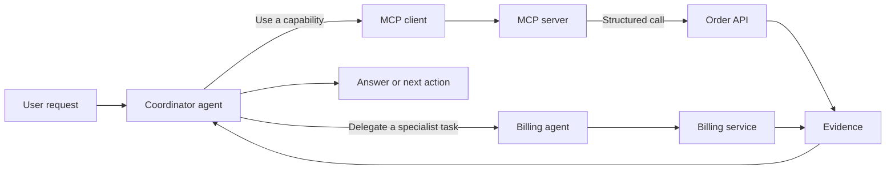

A team adds an AI assistant and soon asks it to check orders, search documents, and delegate a complicated request to another specialist assistant. The word “integration” now covers several different relationships.

An **API** lets software call a service. The **Model Context Protocol (MCP)** gives an AI client a structured way to discover and use tools, resources, and prompts. **Agent-to-agent (A2A)** communication lets one agent ask another agent to collaborate on work.

These can coexist. MCP does not make APIs obsolete, and A2A is not a more fashionable name for a tool call. The useful design question is which party needs to communicate with which other party, and what boundary should remain visible.

## 1. Start with the direction of the request

The simplest distinction is the direction and responsibility of the call.

| Connection | Main relationship | Example question | What the caller expects |
| --- | --- | --- | --- |
| API | Application to service | “What is the status of order 1842?” | A defined request and a structured response |
| MCP | AI client to tools, resources, or prompts | “Find the order policy and call the order-status tool.” | Discoverable capabilities that can be presented to a model |
| A2A | Agent to agent | “Ask the finance agent to investigate this payment exception.” | Another agent to carry out a bounded capability and report back |

The names describe the communication boundary, not a guarantee of reliability or safety. An API can be badly designed. An MCP server can expose too much. An A2A collaboration can create an expensive loop.

## 2. Where each connection fits

### 2.1. APIs: stable application contracts

An API is usually the most direct choice when an application already knows what it needs. A checkout service can call a payment API, validate the response, and handle errors with ordinary program logic.

That explicitness is valuable for deterministic operations. The service can define authentication, input validation, rate limits, versioning, and error codes without asking a model to decide what the operation means.

### 2.2. MCP: a model-facing capability boundary

MCP is useful when AI clients need a consistent way to discover and use capabilities. A server can describe tools, resources, and prompts in a form an MCP client can present to a model.

The underlying capability may still call an API, query a database, or read a file. MCP is a layer around that capability for model-facing use. It can make the tool easier to reuse across clients, but it does not remove the need for authorization, validation, logging, or a clear description of side effects.

### 2.3. A2A: collaboration between distinct agents

A2A is useful when another agent has a separate role, context, or responsibility. A triage agent might ask a billing agent to investigate an invoice, then use the returned finding as one input to its response.

That boundary can preserve ownership: the billing agent knows its own data and process, while the triage agent coordinates the larger task. It also adds network, identity, timeout, and disagreement problems. Delegation should be justified by a real boundary, not by a desire to make a diagram look more autonomous.

## 3. See the three layers in one workflow

The same workflow can contain all three relationships. The coordinator can use an MCP tool to search an order system, call a normal API through that tool, and ask a separate billing agent to investigate an exception.

The diagram does not mean every system should be built this way. A direct API call may be clearer when the application already knows the operation. A single agent may be enough when there is no separate responsibility to delegate.

## 4. Choose the smallest boundary that works

Use an API when:

- The caller and operation are known in advance.
- The service needs a stable contract and predictable error handling.
- The operation is sensitive or consequential enough to keep model discretion narrow.

Use MCP when:

- Several AI clients need to discover the same tools or resources.
- The model needs to choose among capabilities based on the request.
- Tool descriptions, input schemas, and result handling are part of the model-facing experience.

Use A2A when:

- Another agent owns a distinct capability or context.
- The task benefits from delegation and a returned result can be inspected.
- You can define identity, scope, timeouts, failure behavior, and a stopping rule.

These are not mutually exclusive choices. “MCP server backed by an API” is a normal composition. “Coordinator agent delegates to another agent that uses MCP tools” is also possible. Each additional boundary should have a reason that survives a failure review.

## 5. Treat connections as security boundaries

The most important question is not whether an agent can reach a system. It is what the connection allows it to do.

Give each tool or agent the smallest useful permission. Separate read operations from writes. Show users when an action can change data. Validate arguments at the service boundary instead of trusting a model-generated call. Preserve the source and identity of returned content so an instruction inside a document cannot silently become a new authorization.

MCP's [security best-practices documentation](https://modelcontextprotocol.io/docs/2026-07-28/tutorials/security/security_best_practices) is a useful checklist for authorization and server design. The [MCP specification](https://blog.modelcontextprotocol.io/posts/2026-07-28/) and the [official TypeScript and Python SDKs](https://github.com/modelcontextprotocol/servers) are versioned implementation references. For agent collaboration, use the [A2A v1.0 announcement](https://a2a-protocol.org/dev/blog/2026/03/12/a2a-protocol-ships-v10-production-ready-standard-for-agent-to-agent-communication/) and verify the current protocol documentation before implementing against it.

## 6. Make failures visible

A useful connection contract says what happens when:

- the tool is unavailable;
- the API returns an incomplete or contradictory response;
- the delegated agent times out;
- the result contains untrusted instructions;
- the user did not authorize the requested write;
- two agents disagree;
- the system has no evidence strong enough to continue.

A fallback such as “try another agent” can multiply cost and hide the real failure. Often the better fallback is to return the partial evidence, explain what is missing, and ask for a human decision.

## 7. An integration review

Before adding a new connection, write down:

1. Who is the caller?
2. Who owns the data or capability?
3. Does the caller need a fixed contract, model-discoverable tools, or another agent’s judgment?
4. What permissions are granted?
5. What counts as a successful result?
6. How does the system stop when the boundary fails?
7. Can a reviewer trace the request, identity, source, and side effect?

The protocol is only one part of the design. A clear boundary, narrow permission, inspectable result, and explicit stopping rule matter more than whether the architecture contains one protocol or three.
