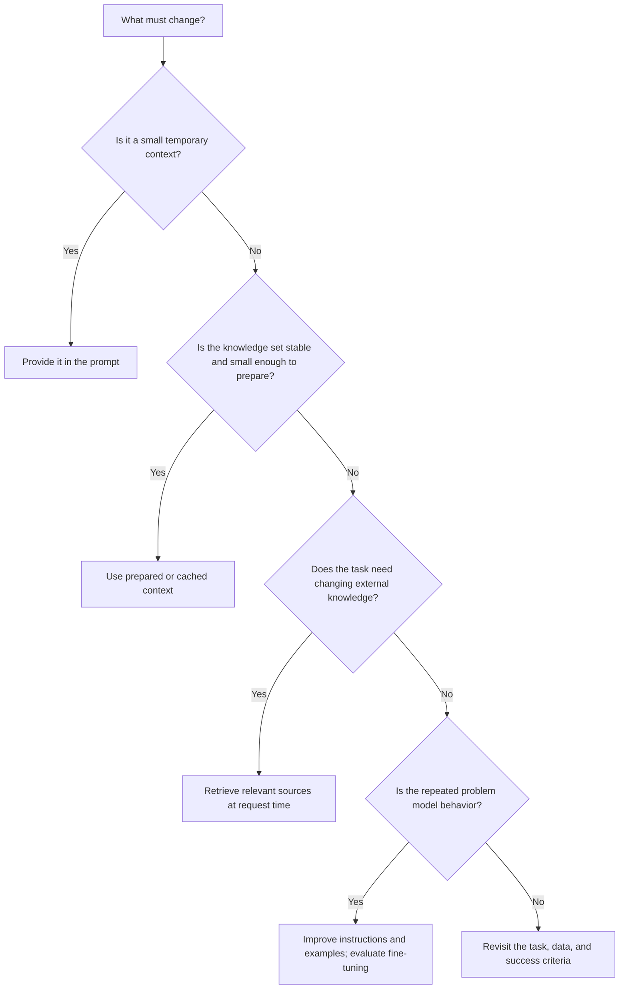

A team asks an internal assistant, “What is the current process for requesting parental leave?” The assistant needs the company’s policy, but the best way to provide that policy depends on how much material exists, how often it changes, and whether the answer must respect the reader’s permissions.

That is the decision behind **retrieval-augmented generation (RAG)**, **context-augmented generation (CAG)**, fine-tuning, and ordinary prompting. They are not four interchangeable ways to make a model “know more.” They put different kinds of knowledge in different places.

The useful question is not “Which technique is the most advanced?” It is “What kind of knowledge does this workflow need, and how should it reach the model?”

## 1. Separate knowledge from behavior

Before choosing a technique, separate two problems that are often mixed together.

**Knowledge** is information the system needs to use: a policy, product catalog, codebase, research notes, or current account data. Knowledge may become stale, may have access rules, and may be too large to put in every request.

**Behavior** is how the model should respond: a tone, a classification pattern, a preferred output shape, or a repeated transformation. Behavior can be improved with instructions, examples, and sometimes fine-tuning.

A new policy document is a knowledge problem. A support assistant that consistently returns the wrong JSON shape is a behavior problem. Treating both as fine-tuning makes the system harder to update and harder to inspect.

## 2. Four ways to provide what the model needs

The names are useful only when they make the trade-off clearer.

| Approach | What enters the model's work | Works well when | Main limitation |
| --- | --- | --- | --- |
| Prompting | A small amount of explicit information in the request | The task has a small, temporary context | The person or application must supply the right facts every time |
| CAG | A known body of context is prepared or cached before repeated requests | The knowledge set is reasonably stable and can fit the context budget | A stale or oversized context is still stale or oversized |
| RAG | Relevant pieces are retrieved at request time | The corpus is large, changing, or too expensive to send whole | Retrieval can miss the right passage, return the wrong one, or ignore permissions |
| Fine-tuning | Model behavior is changed through training examples | A stable pattern or style repeats across many examples | It is a poor place for frequently changing facts and adds a training lifecycle |

**CAG** is not a single universally agreed protocol name. In this article, it means preparing a stable knowledge set in the model’s context or cache before the request. Some sources use the term differently, so an implementation should define exactly what is loaded, when it is refreshed, and who can see it.

Fine-tuning can make a model behave differently, but it does not turn a changing document store into a reliable live database. A model may reproduce a fact it learned during training while missing the updated version that a user needs today.

## 3. Use the smallest mechanism that fits the knowledge

Imagine a hypothetical onboarding assistant.

It has a short, stable “first day” checklist used by one team. Supplying that checklist as context may be enough. There is no reason to build a retrieval index for a document that fits comfortably in the request and changes once a year.

Now imagine an assistant that answers questions over thousands of policy, benefits, and security documents. Sending every document on every request is wasteful. RAG can retrieve the passages related to the question, then give those passages to the model with their source information.

Finally, suppose the assistant understands the policies but keeps returning a paragraph when the application requires a structured object. That is primarily a behavior and interface problem. Better instructions and examples may solve it; a fine-tune may become reasonable only after the pattern is stable, the examples are representative, and the evaluation shows that the investment is worthwhile.

The choice can change as the workflow changes. A pilot may start with a pasted context, move to retrieval as the corpus grows, and add a behavior change only after repeated evidence shows that instructions are not enough.

## 4. RAG retrieves evidence; it does not create authority

RAG is often described as a way to reduce hallucination. Retrieval can give the model better evidence, but it does not guarantee a correct answer.

A useful RAG workflow still has to answer several questions:

- Did the retriever find the right document and the right version?
- Were the returned passages split in a way that kept their meaning?
- Can this user see the retrieved content?
- Do two documents disagree, and can the assistant surface that conflict?
- Does the answer cite the passages that support it?
- What should happen when no passage is strong enough to answer?

For a policy assistant, “I could not find a current policy that answers this” may be safer than a fluent guess. Retrieval is part of the evidence path; it is not a substitute for permissions, source ownership, or human review.

## 5. Let the knowledge path follow the task

This is a starting conversation, not an automatic architecture generator. Security boundaries, latency, cost, and the quality of the source material can change the answer.

## 6. Build a small, inspectable path first

A practical workshop exercise is to build one internal knowledge assistant in stages:

1. Start with a small set of clearly labeled documents.
2. Ask the model to answer only from the supplied material.
3. Add source references to the answer.
4. Test questions whose answers are present, missing, outdated, and contradictory.
5. Add retrieval when the corpus or freshness requirement makes whole-document context impractical.
6. Measure whether retrieval improves the cases that matter before adding more infrastructure.

This gives the team a visible evidence path. When an answer is wrong, someone can inspect the question, retrieved passages, permissions, and final response instead of guessing whether a hidden training change helped.

## 7. A decision checklist

Before choosing a technique, write down:

- How large is the knowledge set today, and how large will it become?
- How often does it change?
- Who is allowed to see each part?
- Does the answer need citations or a source trail?
- Is the recurring problem missing facts or inconsistent behavior?
- What is the cost of a stale or incorrect answer?
- What test will show that the chosen approach is better?

The [IBM overview of RAG](https://www.youtube.com/watch?v=T-D1OfcDW1M), its comparison of [RAG and CAG](https://www.youtube.com/watch?v=HdafI0t3sEY), and its discussion of [RAG, fine-tuning, and prompt engineering](https://www.youtube.com/watch?v=zYGDpG-pTho) are useful starting points. For long-running systems, the [OpenAI memory and compaction example](https://developers.openai.com/cookbook/examples/agents_sdk/building_reliable_agents_memory_compaction) shows why context management remains part of the design.

The best architecture is usually the one that puts each kind of knowledge where the team can update, permission, inspect, and evaluate it. Start with the smallest path that makes those responsibilities visible.
