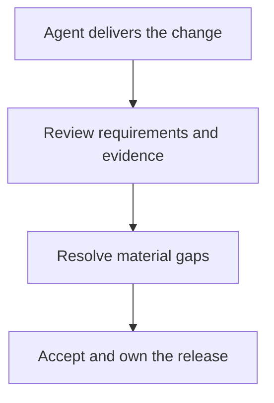

“I didn’t write that. Claude did.”

As an explanation of where a change came from, fine. As an answer to why broken code was accepted and shipped, it irritates me.

You chose to use the agent. You decided what to ask it. Somewhere between its output and a release, somebody decided the work was ready. The model’s name does not answer for that decision.

I want agents to write more of my code. I want to spend less time wiring familiar things together and more time reviewing plans, making architecture decisions, and learning. That is the working style I described in [my previous post](/blog/100-times-more-software-engineering-with-ai).

But I cannot claim the benefit of delegating implementation and then treat its consequences as somebody else’s problem.

> “The agent wrote it” tells me how the code was produced. Tell me why you accepted it.

## 1. Writing the code and accepting the work are different jobs

### 1.1. You can delegate a lot more than typing

An agent can propose a design, implement it, write tests, inspect a failure, and revise the result. I do not need to reserve every interesting task for myself to remain responsible for the work.

What I need is a defensible basis for accepting it.

Why does this design fit the requirement? Which existing contract must survive? What behavior have we actually checked? Which assumptions are still uncertain? Who can stop or reverse the release if those assumptions fail?

Those questions remain useful whether I typed the implementation, paired with another engineer, or asked Codex to carry it through.

### 1.2. Responsibility does not require perfect foresight

Owning a change does not mean promising it contains no defects. That would make ownership impossible for human-written software too.

It means taking reasonable steps to understand the consequential choices, checking the behavior that matters, being honest about what remains unknown, and responding when the result is wrong.

There is a substantial difference between “we checked this boundary and missed a case” and “I don’t know; the agent did it.” The first gives us something to investigate and improve. The second tries to end the conversation at the point where engineering work is needed.

## 2. A working export can still be the wrong export

Imagine a hypothetical application where each customer organization can export its own invoices. An engineer asks an agent to add a CSV download, keeping the filters already available on the invoices page.

The agent builds the endpoint, connects the button, and adds a test. The download works. Dates and amounts appear in the right columns. The test passes.

The implementation is missing one important constraint: the export query is not restricted to the requesting user’s organization.

This is an invented example, not an incident from one of my projects. It makes the acceptance problem visible: the feature can look finished while violating the reason it is safe to offer at all.

### 2.1. What did the green test establish?

A test with one organization and three invoices can show that the file contains those three invoices. It cannot establish separation between organizations that the fixture never represented.

If the agent assumes that an authenticated user can access every matching invoice, it may carry that assumption into both the implementation and the test. Asking the same agent whether its tests pass does not introduce the missing requirement.

The engineer accepting this work needs to connect the feature to the application’s actual access rules. The export button is only one route into that behavior; the endpoint needs to enforce those rules too.

| What looks finished                          | What still needs an answer                                           |
| -------------------------------------------- | -------------------------------------------------------------------- |
| The CSV downloads                            | Which organization’s records can it contain?                         |
| The normal example passes                    | Does another organization’s data stay out?                           |
| The button is hidden from unauthorized users | What happens when someone calls the endpoint directly?               |
| The agent reports success                    | Which checks produced that conclusion, and against what requirement? |

### 2.2. Naming the model does not resolve the failure

“Claude forgot the organization filter” may be a useful detail during diagnosis. Perhaps the prompt omitted it. Perhaps project documentation failed to make the rule discoverable. Perhaps the agent ignored an explicit instruction.

Those are different causes, and I want to know which one happened. But none of them explains why the change was accepted without evidence about that boundary.

The response should be to contain the problem, fix it, and examine the path that let it through. If a team’s instructions, review process, or release pressure contributed, those need attention too. Making one engineer absorb every organizational failure would be another way to avoid understanding what happened.

## 3. Review according to consequence, not line count

### 3.1. Reading everything is not the only way to understand a change

One response to this problem is to insist that an engineer must personally inspect every generated line. I do not think that is a useful universal rule.

A repetitive layout change and a change to data access deserve different kinds of attention. Reading every class name does not compensate for missing the query that crosses an organization boundary.

For the hypothetical export, I would concentrate on where access is established, where the query is scoped, how filters reach it, and how the endpoint behaves when the request is invalid or unauthorized. I would want evidence from cases that can expose a mistake in those places.

The agent can help map those paths, run the checks, and collect the results. I still have to judge whether the evidence addresses the requirement. If I cannot yet explain an important part of the design, that is a reason to investigate it before accepting the work.

### 3.2. Make the acceptance decision visible

A short note can make this much easier to review. For our imaginary export, useful notes might look like this **after the described checks have actually been performed**:

```text
Requirement:
Export only the requesting user's
organization, with the active filters.

Checked:
- Two organizations in the fixture;
  neither export includes the other's data.
- Direct requests without permission
  are rejected by the endpoint.
- Date filters affect the downloaded rows.

Not checked:
- Export behavior at very large volumes.
  Resolve the expected volume before release.
```

That last item matters. An honest limit gives the reviewer an actual decision: is this ready for the expected use, or do we need more work? “All good, tests pass” hides both the evidence and its limits.

I do not need an essay for every small change. I need enough information to see what we are accepting.

## 4. Give the agent a better definition of done

### 4.1. Ask for evidence while the task is still small

If I ask only for an implementation, I should not be surprised when the output is organized around producing one. I can ask the agent to carry the work further:

```text
Implement the agreed change while
preserving the existing access rules.

Before declaring it ready:
- Identify the consequential boundaries.
- Check behavior against the requirements.
- Exercise the actual user-facing path.
- Report failed, skipped, or blocked checks.
- List assumptions still unverified.

Separate observed results from claims.
Do not turn an unknown into a pass.
```

This is a useful task instruction, not a guarantee. The agent can still misunderstand a boundary or choose a weak check. Project context, review, and observation of the actual result remain necessary.

### 4.2. Unknowns need a decision

When evidence is missing, the next action might be another test, a narrower implementation, a fresh review, or a question to the person who knows the requirement. It should not disappear inside a confident completion message.



Resolving a gap can send us back through implementation and review. The point is to make delegation useful: if I can ask an agent to implement, investigate, and verify a complete piece of work, I have less mechanical work left to do myself. Acceptance is where I decide whether that delegation has produced something we can rely on.

## 5. Keep the provenance. Drop the escape clause.

Knowing that a change was agent-generated can help explain how a mistake spread. A missing constraint in project instructions might affect the next task too. A weak verification habit might need to change across the team. I do not want to hide that information.

I also do not want responsibility reduced to blame. Engineers need room to report uncertainty and mistakes early. Punishing every admitted limit encourages the confident “done” message that tells us the least.

What I expect from an engineer is practical:

1. **Define what must hold.** Give the agent the relevant requirements and boundaries, then check its interpretation.
2. **Examine consequential choices.** Spend attention where a wrong decision changes behavior, access, data, or the cost of future work.
3. **Accept evidence you can explain.** Know what was checked, what the results establish, and what they leave open.
4. **Stay with the outcome.** Help diagnose and repair a failure instead of pointing back at the tool.

I am happy to say an agent wrote most of a change. That is often exactly what I wanted it to do.

When I accept that change, I should be able to say why. When it fails, I should be prepared to help fix it. Neither obligation depends on whose hands were on the keyboard.
