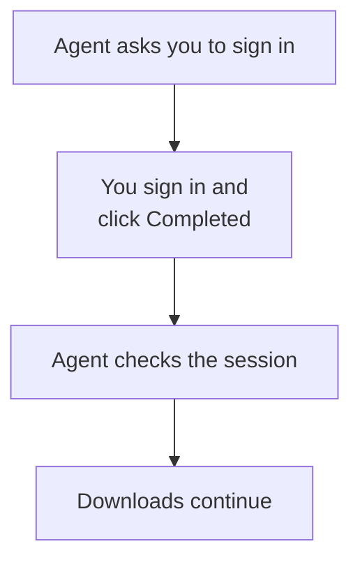

An agent is partway through a long task when it reaches a sign-in screen. The remaining work is straightforward once the session is available, but signing in needs you.

It could end with an unfinished-task report. Or it could spend ages trying alternate routes around a step you could complete in a moment.

There's a more useful option: ask you to step in, wait for your response, and continue from there.

That's what my **request-user-action** skill provides. It gives the agent a desktop dialog for a concrete manual action and a return signal it can use to resume. This is a small part of autonomous work, but it can determine whether a long task reaches its intended finish.

## 1. Ask for the missing action

Imagine an agent collecting documentation from a portal into a local folder. This is a hypothetical example. It has already gathered some files, then reaches a page that requires your account to be signed in.

The agent has a clear next step after login, so the useful request is specific: sign in to the portal in the indicated tab, then choose **Completed** in the dialog. **Cancel** lets you say the action can't be done now.

The request needs enough context to make sense on its own. “Help needed” sends you back to the conversation to discover what's wrong. Naming the portal, tab, and action lets you do the missing step and return to what you were doing.

The current helper uses a desktop dialog and attempts an attention sound. It needs Bash, Zenity, and a Linux graphical session; sound is best effort. The skill also provides a chat fallback when the dialog can't be shown.

## 2. Keep the task connected to the reply

The agent keeps the helper in a tracked shell session so the task can resume when a result arrives. When the dialog closes, the helper returns a status, and the agent can take the next step. The host needs to support waiting for that result; the helper doesn't create a background agent of its own.

The successful sign-in path has four steps:

For the documentation task, **Completed** means it's time to check the portal again. The agent should confirm that the expected session is available and that it can reach the required page before continuing the download. A click doesn't establish that login succeeded; the session could still be unavailable or belong to the wrong account.

If the check fails, the next response can explain what is still missing. If you choose **Cancel**, the agent retains the unfinished step instead of treating it as success.

That return path is what makes this more than a notification. The agent knows what it is waiting for and what observation should allow it to continue.

## 3. Add it to the task you are already delegating

The [Prompt Library page](/prompts/request-user-action) contains the full skill and a ZIP with its shell helper. Keeping those files together matters because the prompt calls the helper by its relative path.

A request can stay short:

> Continue collecting the documentation. Use request-user-action if you need me to sign in, then carry on once the session is available.

The skill is for an action only you can perform, such as signing in or reconnecting a device. Ordinary questions can stay in chat. A completion response also leaves the original task's scope intact; it doesn't authorize unrelated actions.

No portal login, dialog, or sound was run for this article. The example explains the handoff: pause at the manual step, get your response, inspect the result, and pick up the work that was already underway.
